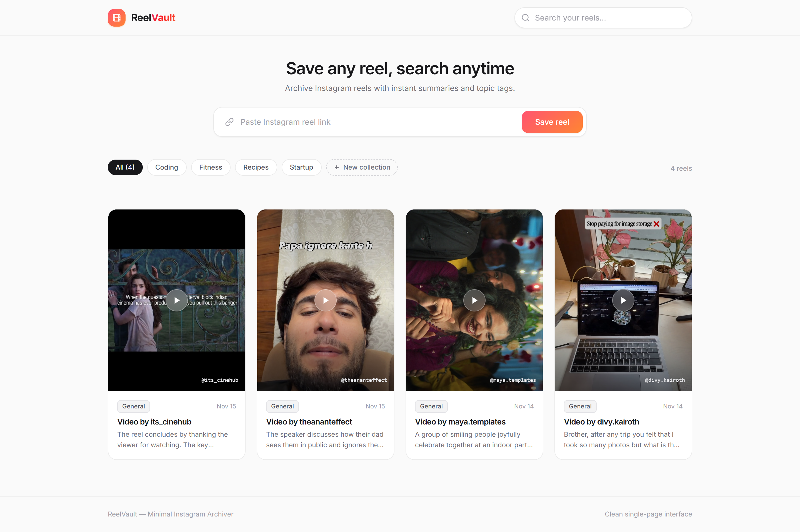
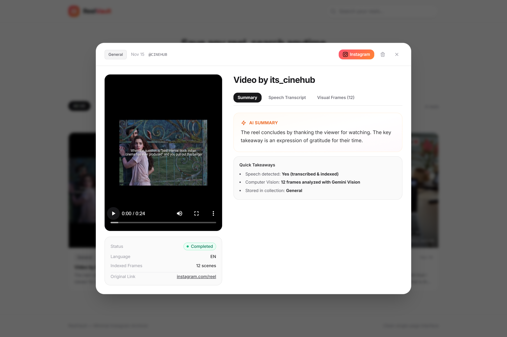
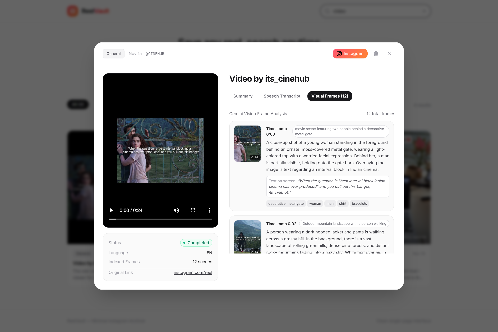

<div align="center">

# 🎬 ReelVault

### AI-Powered Instagram Reel Archiver & Multimodal Knowledge Base

**Save it. Understand it. Search it anytime.**

ReelVault transforms ephemeral short-form video into a structured, searchable personal knowledge base. By combining speech-to-text transcription, computer vision scene understanding, vector embeddings, and LLM summarization, ReelVault makes Instagram reels searchable by concept, dialogue, and visual content.

---

[](https://fastapi.tiangolo.com)
[](https://react.dev)
[](https://vitejs.dev)
[](https://tailwindcss.com)
[](https://aistudio.google.com)
[](https://github.com/openai/whisper)
[](https://www.trychroma.com)
[](https://www.mongodb.com)

</div>

---

## 📸 Showcase & Screenshots

### 1. Main Dashboard & Library Grid
Clean, minimalist interface with immediate reel preview, collection filters, search bar, and background processing indicator.



---

### 2. Comprehensive Reel Detail Modal
Inspect any archived reel with an embedded video player, metadata tags, and three detailed analytical tabs.



---

### 3. Visual Frame Understanding
Key video scenes extracted via FFmpeg and individually analyzed by Gemini Vision to detect actions, text, and visual context.


---

### 4. Real-Time Semantic Search & Filtering
Search your library naturally by meaning, spoken topics, or visual descriptions rather than exact keywords.



---

## ✨ Key Features

* ⚡ **Instant Download & Quick UI Refresh**  
  Reel metadata, direct video, and thumbnails download in **1–2 seconds** using `yt-dlp`. The card immediately appears on the grid while the heavier AI pipeline runs asynchronously in the background.

* 🎙️ **Speech Transcription (OpenAI Whisper)**  
  Audio is extracted from the video via FFmpeg and automatically transcribed with timestamp awareness and silence handling.

* 👁️ **Visual Scene Understanding (Gemini 3.5 Flash-Lite Vision)**  
  Significant scene-change frames are extracted and analyzed using Gemini Vision to capture text overlays, visual context, people, and actions.

* 🧠 **Multimodal Vector RAG (ChromaDB + Embeddings)**  
  Transcripts and frame descriptions are indexed into ChromaDB. Natural-language queries retrieve relevant reels by semantic meaning.

* 📝 **AI Summarization & Takeaways**  
  Generates concise overviews and key takeaways for each reel using Google Gemini LLM.

* 🗂️ **Collections & Organization**  
  Filter reels by preset categories (*Coding, Fitness, Recipes, Startup*) or create custom user collections with instant client-side persistence.

* 🗑️ **Safe Cascading Deletion**  
  Deleting a reel completely removes its MongoDB record, ChromaDB vector embeddings, downloaded MP4, audio files, and extracted frame images—leaving other reels unaffected.

---

## 🏗️ Architecture & Pipeline

```
                       User pastes Instagram Reel URL
                                    │
                                    ▼
                         FastAPI: /reels/process
                                    │
          ┌─────────────────────────┴─────────────────────────┐
          │ Synchronous (1-2s)                                │
          ▼                                                   ▼
     yt-dlp Download                               Save to MongoDB
  (MP4 Video & Thumbnail)                        (Status: "processing")
          │                                                   │
          ▼                                                   ▼
  Return HTTP 200                                Immediate UI Render
  (Video & Thumbnail)                         (⚡ "Processing AI..." badge)
          │
          ▼  FastAPI BackgroundTasks
  ┌───────────────────────────────────────────────────────────┐
  │ 1. extract_audio (FFmpeg audio extraction)                │
  │ 2. transcribe_audio (OpenAI Whisper Speech-to-Text)       │
  │ 3. extract_frames (FFmpeg scene detection & extraction)   │
  │ 4. understand_frames (Gemini 3.5 Flash-Lite Vision)       │
  │ 5. index_frames_and_transcript (ChromaDB Vector Store)    │
  │ 6. summarize_reel (Gemini LLM Summarizer)                 │
  │ 7. finalize_processing (MongoDB Status: "completed")       │
  └─────────────────────────────┬─────────────────────────────┘
                                │
                                ▼
                       Frontend Polling (3s)
                                │
                                ▼
                   Card Updates with AI Summary!
```

---

## 🛠️ Tech Stack

| Layer | Technologies |
|---|---|
| **Frontend** | React 18, Vite, Tailwind CSS, Lucide Icons, Fetch API |
| **Backend API** | FastAPI, Uvicorn, LangGraph, Motor (Async MongoDB Driver) |
| **AI Models** | Google Gemini 3.5 Flash-Lite, OpenAI Whisper, Sentence-Transformers |
| **Databases** | MongoDB (Document Storage), ChromaDB (Vector Store) |
| **Media Processing** | FFmpeg, yt-dlp |

---

## 📂 Project Structure

```text
ReelVault/
├── backend/
│   ├── app/
│   │   ├── database/
│   │   │   └── db.py                  # MongoDB async connection (Motor)
│   │   ├── graph/
│   │   │   ├── nodes.py               # LangGraph pipeline processing nodes
│   │   │   ├── state.py               # ReelGraph state schema
│   │   │   └── workflow.py            # LangGraph workflow definition
│   │   ├── rag/
│   │   │   ├── rag.py                 # Hybrid RAG & search implementation
│   │   │   └── visual_rag.py          # Visual embeddings & retrieval
│   │   ├── routes/
│   │   │   ├── process.py             # Reel processing & background tasks
│   │   │   └── reel.py                # CRUD, library, search & delete routes
│   │   ├── services/
│   │   │   ├── download_reel.py       # yt-dlp Instagram reel downloader
│   │   │   ├── extract_audio.py       # FFmpeg audio extractor
│   │   │   ├── extract_frames.py      # FFmpeg scene frame extractor
│   │   │   ├── transcribe.py          # OpenAI Whisper transcription
│   │   │   ├── visual_understanding.py# Gemini Vision frame analysis
│   │   │   ├── visual_embeddings.py   # Vector embeddings service
│   │   │   ├── summarize.py           # Gemini LLM summarizer
│   │   │   └── reel_store.py          # Reel database persistence
│   │   └── main.py                    # FastAPI entrypoint & static mount
│   ├── .env.example                   # Backend environment template
│   ├── .gitignore                     # Backend gitignore rules
│   └── requirements.txt               # Backend Python dependencies
│
├── frontend/
│   ├── public/                        # Static assets
│   ├── src/
│   │   ├── components/
│   │   │   ├── AddReelForm.jsx        # Reel link input & submission
│   │   │   ├── CollectionsBar.jsx     # Category pills & collection modal
│   │   │   ├── DeleteConfirmModal.jsx # Delete confirmation dialog
│   │   │   ├── EmptyState.jsx         # Empty library illustration
│   │   │   ├── Header.jsx             # Top bar navigation & search
│   │   │   ├── NewCollectionPopup.jsx # Custom collection creator
│   │   │   ├── ReelCard.jsx           # Grid reel card with status badges
│   │   │   ├── ReelDetailModal.jsx    # Video player & tabbed inspector
│   │   │   ├── ReelGrid.jsx           # Responsive reel cards grid
│   │   │   ├── SaveToast.jsx          # Notification toast component
│   │   │   └── SearchBar.jsx          # Debounced semantic search input
│   │   ├── api.js                     # Backend API client
│   │   ├── utils.js                   # Date formatters & helpers
│   │   ├── App.jsx                    # Root application component
│   │   ├── main.jsx                   # React DOM entrypoint
│   │   └── index.css                  # Tailwind directives & styles
│   ├── .env.example                   # Frontend environment template
│   ├── tailwind.config.js             # Tailwind configuration
│   ├── vite.config.js                 # Vite build & proxy config
│   └── package.json                   # Frontend dependencies & scripts
│
├── docs/
│   └── screenshots/                   # Application showcase screenshots
│       ├── dashboard.png
│       ├── reel_detail_modal.png
│       ├── visual_frames.png
│       └── search_filter.png
│
├── .gitignore                         # Project-wide gitignore
└── README.md                          # Project documentation
```

---

## 🚀 Getting Started

### Prerequisites

* **Python 3.10+**
* **Node.js 18+** & npm
* **MongoDB** (running locally on `mongodb://localhost:27017`)
* **FFmpeg** installed and accessible in your system `PATH`
* **Google Gemini API Key** ([Get a key here](https://aistudio.google.com/))

---

### 1. Clone the Repository

```bash
git clone https://github.com/iam2498/ReelVault.git
cd ReelVault
```

---

### 2. Backend Setup

1. **Navigate to the backend directory**:
   ```bash
   cd backend
   ```

2. **Create and activate a virtual environment**:
   * **Windows**:
     ```bash
     python -m venv venv
     venv\Scripts\activate
     ```
   * **macOS / Linux**:
     ```bash
     python3 -m venv venv
     source venv/bin/activate
     ```

3. **Install dependencies**:
   ```bash
   pip install -r requirements.txt
   ```

4. **Configure environment variables**:
   Copy `.env.example` to `.env`:
   ```bash
   cp .env.example .env
   ```
   Fill in your configuration:
   ```env
   # MongoDB Connection
   MONGO_URI=mongodb://localhost:27017
   MONGO_DB_NAME=reelvault

   # Runtime Data Directories
   DOWNLOADS_DIR=downloads
   AUDIO_DIR=audio
   FRAMES_DIR=downloads
   CHROMA_DB_PATH=chroma_db

   # Gemini API Key
   GEMINI_API_KEY=your_gemini_api_key_here

   # Gemini Models
   GEMINI_VISION_MODEL=gemini-3.5-flash-lite
   GEMINI_SUMMARY_MODEL=gemini-3.5-flash-lite
   GEMINI_EMBEDDING_MODEL=text-embedding-004
   ```

5. **Start the backend server**:
   ```bash
   uvicorn app.main:app --host 127.0.0.1 --port 8000 --reload
   ```

   The backend will be available at: `http://127.0.0.1:8000`  
   Interactive Swagger API documentation: `http://127.0.0.1:8000/docs`

---

### 3. Frontend Setup

1. **Navigate to the frontend directory**:
   ```bash
   cd ../frontend
   ```

2. **Install dependencies**:
   ```bash
   npm install
   ```

3. **Configure environment variables**:
   Copy `.env.example` to `.env`:
   ```bash
   cp .env.example .env
   ```
   Ensure the backend API URL is set:
   ```env
   VITE_API_URL=http://localhost:8000
   ```

4. **Start the Vite development server**:
   ```bash
   npm run dev
   ```

   Open `http://localhost:5173` in your browser.

---

## 📡 API Reference

| Method | Endpoint | Description |
|---|---|---|
| `POST` | `/reels/process` | Download reel, create record, and trigger background AI pipeline |
| `GET` | `/reels/library` | Retrieve all saved reels sorted by creation date |
| `GET` | `/reels/search?q={query}` | Hybrid semantic vector search across speech & visual content |
| `DELETE` | `/reels/{video_id}` | Cascading deletion of reel data, vectors, and local media files |
| `GET` | `/downloads/{filepath}` | Static file serving for video MP4s and extracted frame images |

---

## 🛡️ Security & Privacy

* Sensitive files such as `.env`, downloaded MP4 videos, audio tracks, and ChromaDB vector files are **excluded from version control** via comprehensive `.gitignore` rules.
* Use `.env.example` templates to configure credentials in production or local environments.

---

## 📄 License

This project is open-source and available under the [MIT License](LICENSE).
